# Análisis de Redes y Sistemas de Recomendación
### Modelos híbridos, inferencia estadística y controlabilidad

**Universidad Yachay Tech | Maestría en Ciencia de Datos | Taller III**

Este repositorio presenta un estudio computacional de interacciones entre usuarios y películas utilizando teoría de grafos, aprendizaje automático, inferencia estadística y sistemas dinámicos.

El objetivo es comparar diferentes algoritmos de recomendación, analizar su robustez y estudiar cómo cambia su rendimiento según el protocolo de evaluación.

---

## Contenido

1. [Introducción](#1-introducción)
2. [Conjunto de datos](#2-conjunto-de-datos)
3. [Fundamentos matemáticos](#3-fundamentos-matemáticos)
4. [Análisis de redes](#4-análisis-de-redes)
5. [Sistemas de recomendación](#5-sistemas-de-recomendación)
6. [Modelo híbrido](#6-modelo-híbrido)
7. [Inferencia estadística](#7-inferencia-estadística)
8. [Evaluación de recomendaciones](#8-evaluación-de-recomendaciones)
9. [Validación temporal](#9-validación-temporal)
10. [Controlabilidad de redes](#10-controlabilidad-de-redes)
11. [Discusión científica](#11-discusión-científica)
12. [Conclusiones](#12-conclusiones)
13. [Reproducibilidad](#13-reproducibilidad)
14. [Referencias](#14-referencias)

---

## 1. Introducción

Los sistemas de recomendación buscan estimar las preferencias de los usuarios a partir de información histórica.

En este trabajo se estudian dos perspectivas:

- **Estructural:** representar las interacciones mediante grafos.
- **Predictiva:** estimar calificaciones mediante modelos de aprendizaje automático.

Adicionalmente, se incorporan técnicas de inferencia estadística y controlabilidad para explorar propiedades de las redes y la robustez de los resultados.

### Pregunta principal

**¿La información estructural de una red de películas permite mejorar el rendimiento de un sistema de recomendación basado en factorización matricial?**

La investigación también analiza si una posible mejora se conserva al modificar el procedimiento de evaluación.

## 2. Conjunto de datos

Se utiliza **MovieLens 100K**, desarrollado por GroupLens Research.

| Característica | Cantidad |
|---|---:|
| Usuarios | 943 |
| Películas | 1 682 |
| Calificaciones | 100 000 |
| Escala de calificación | 1–5 |
| Período | 1997–1998 |

Cada registro contiene un identificador de usuario, un identificador de película, una calificación y una marca temporal.

Fuente: [MovieLens 100K](https://grouplens.org/datasets/movielens/100k/).

## 3. Fundamentos matemáticos

### 3.1. Grafo bipartito

Consideramos un grafo:

$$
G=(U\cup M,E),
$$

donde:

- $U$ representa el conjunto de usuarios.
- $M$ representa el conjunto de películas.
- $E$ representa las interacciones de calificación.

Las aristas conectan usuarios con películas, nunca usuarios entre sí ni películas entre sí.

### 3.2. Centralidad de grado

Para un nodo $v$, su grado es:

$$
d(v)=\sum_{u\in V} A_{vu},
$$

donde $A$ es la matriz de adyacencia binaria.

En usuarios, el grado mide actividad. En películas, mide popularidad según el número de calificaciones.

### 3.3. Error de predicción

La raíz del error cuadrático medio (RMSE) es:

$$
\mathrm{RMSE}=
\sqrt{\frac{1}{n}\sum_{i=1}^{n}(r_i-\hat r_i)^2}.
$$

El error absoluto medio (MAE) es:

$$
\mathrm{MAE}=
\frac{1}{n}\sum_{i=1}^{n}|r_i-\hat r_i|.
$$

En ambas métricas, valores menores indican mejores predicciones.

## 4. Análisis de redes

El grafo bipartito completo contiene:

- 2 625 nodos.
- 100 000 aristas.
- 943 nodos de usuarios.
- 1 682 nodos de películas.

### 4.1. Películas más populares

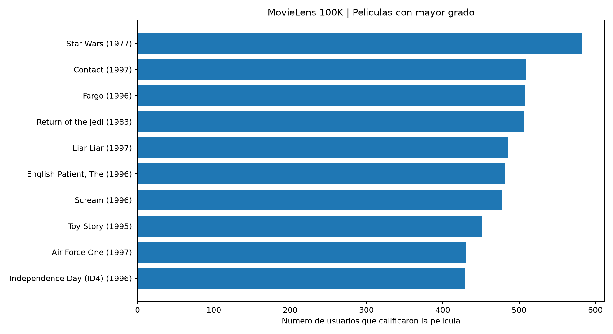

**Interpretación:** *Star Wars (1977)* tiene 583 conexiones y es la película con mayor grado. Esto indica popularidad, pero no implica necesariamente la mayor calificación promedio.

El usuario más activo es el usuario 405, con 737 películas calificadas.

### 4.2. Detección de comunidades

Para explorar comunidades se seleccionó una subred de 120 usuarios y 100 películas, con 8 306 aristas.

Se aplicó el algoritmo Louvain.

| Indicador | Resultado |
|---|---:|
| Comunidades identificadas | 3 |
| Modularidad | 0.0697 |
| Agrupamiento bipartito medio de 30 nodos | 0.6438 |

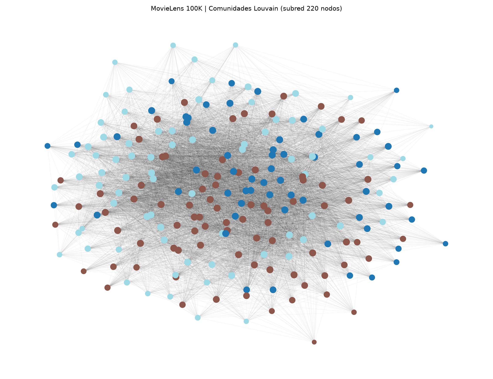

**Interpretación:** la modularidad baja sugiere una separación comunitaria débil. La selección por grado favorece nodos muy conectados y puede influir en las comunidades obtenidas.

El agrupamiento bipartito reportado corresponde solamente a 30 nodos seleccionados, no al grafo completo.

## 5. Sistemas de recomendación

Se implementaron dos algoritmos:

**SVD:** factorización matricial para aprender factores latentes asociados con usuarios y películas.

**KNN ítem-ítem:** predicción basada en similitudes entre películas.

Los hiperparámetros fueron seleccionados mediante validación cruzada dentro del conjunto de entrenamiento.

### Resultados

| Modelo | RMSE | MAE |
|---|---:|---:|
| SVD optimizado | **0.921526** | **0.728525** |
| KNN ítem-ítem | 1.026430 | 0.810381 |

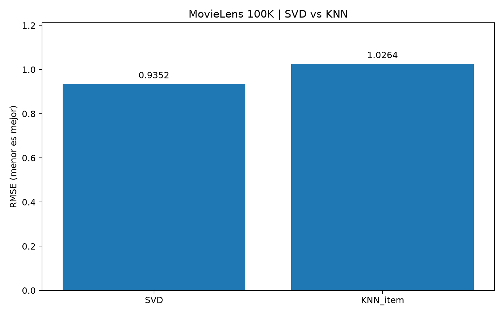

**Interpretación:** SVD obtuvo menor error en las dos métricas.

### Recomendaciones para el usuario 405

| Película | Calificación estimada |
|---|---:|
| It's a Wonderful Life (1946) | 3.289541 |
| Pather Panchali (1955) | 3.014014 |
| Good Will Hunting (1997) | 2.922658 |
| Singin' in the Rain (1952) | 2.880870 |
| As Good as It Gets (1997) | 2.870904 |

Las cinco películas no habían sido calificadas por ese usuario en el conjunto utilizado.

## 6. Modelo híbrido

Se combina una predicción SVD con otra basada en vecinos de una red de similitud entre películas:

$$
\hat r_{ui}^{H}=
(1-\alpha)\hat r_{ui}^{SVD}
+\alpha\hat r_{ui}^{G}.
$$

El parámetro $\alpha$ controla la contribución del componente estructural.

La red del recomendador se construye a partir de las calificaciones de entrenamiento.

### Selección del peso

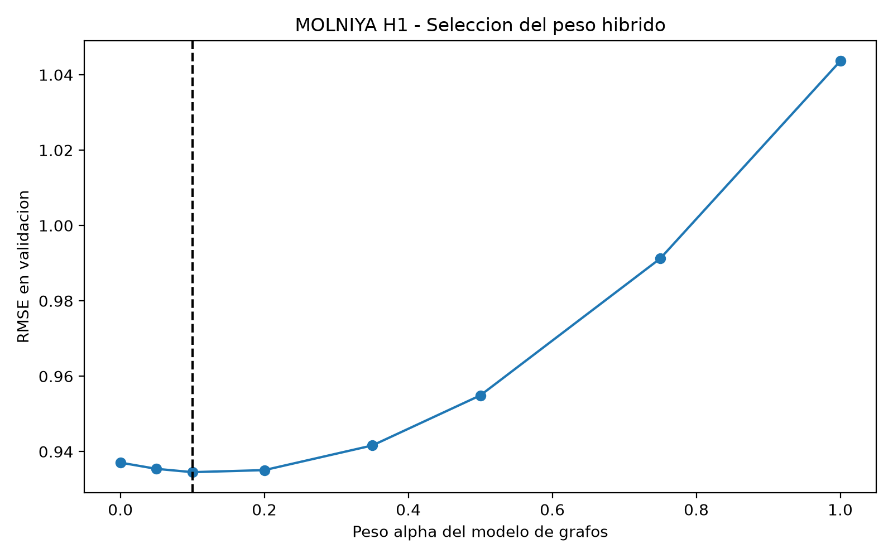

En el experimento inicial se seleccionó $\alpha=0.10$.

| Modelo | RMSE |
|---|---:|
| SVD | 0.921526 |
| Componente de grafo | 1.019949 |
| Híbrido | **0.918956** |

### Robustez ante diferentes particiones

Se evaluaron cinco particiones aleatorias.

| Semilla | RMSE SVD | RMSE híbrido |
|---|---:|---:|
| 11 | 0.924494 | 0.922002 |
| 23 | 0.923976 | 0.920514 |
| 42 | 0.921526 | 0.918749 |
| 67 | 0.919800 | 0.917132 |
| 101 | 0.919847 | 0.917926 |

La mejora media fue **0.002664 unidades de RMSE**, favorable al híbrido en las cinco particiones.

Estos resultados son exploratorios: las particiones comparten observaciones y los hiperparámetros de SVD proceden de una búsqueda anterior.

## 7. Inferencia estadística

Se aplicó bootstrap pareado por usuario para estudiar la incertidumbre de las diferencias de rendimiento.

### SVD frente a KNN

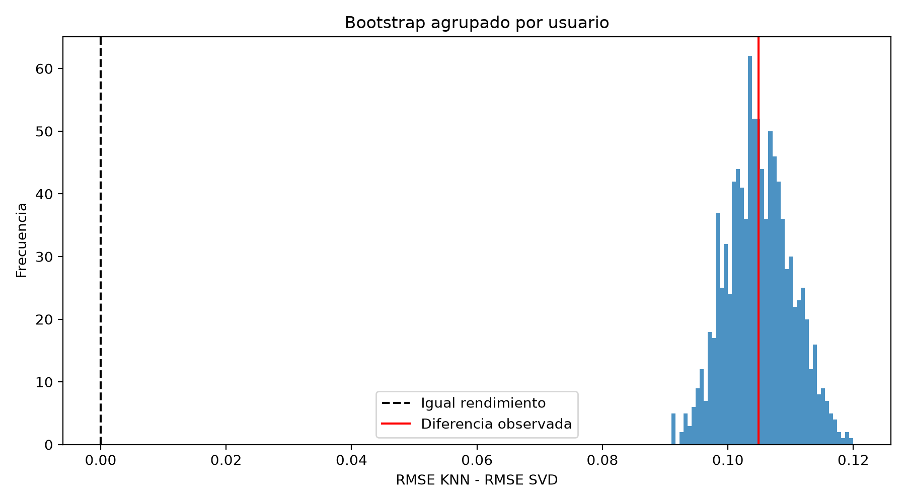

La diferencia observada de RMSE, KNN menos SVD, fue 0.104903.

El intervalo percentil bootstrap al 95 % fue:

$$
[0.095128,\ 0.115331].
$$

### SVD frente al híbrido

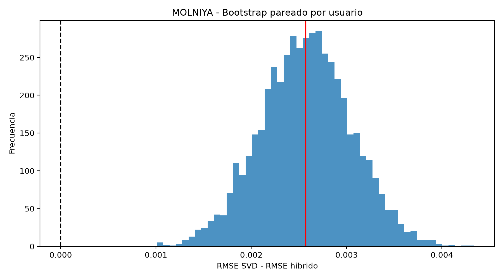

Se realizaron 5 000 réplicas.

La mejora observada fue 0.00257079, con intervalo:

$$
[0.00162837,\ 0.00349981].
$$

El intervalo positivo aporta evidencia favorable al híbrido en este experimento, pero no garantiza su superioridad en otras poblaciones ni otros períodos.

## 8. Evaluación de recomendaciones

Se estudió la calidad del ordenamiento mediante tres métricas:

- **Precisión@5:** proporción de películas relevantes entre las cinco primeras.
- **Exhaustividad@5:** proporción de películas relevantes recuperadas.
- **NDCG@5:** calidad del ordenamiento teniendo en cuenta la posición de cada película relevante.

Una calificación de 4 o 5 se considera relevante.

| Métrica | SVD | Híbrido |
|---|---:|---:|
| Precisión@5 | 0.753754 | 0.756377 |
| Exhaustividad@5 | 0.487101 | 0.488305 |
| NDCG@5 | 0.825756 | 0.829804 |

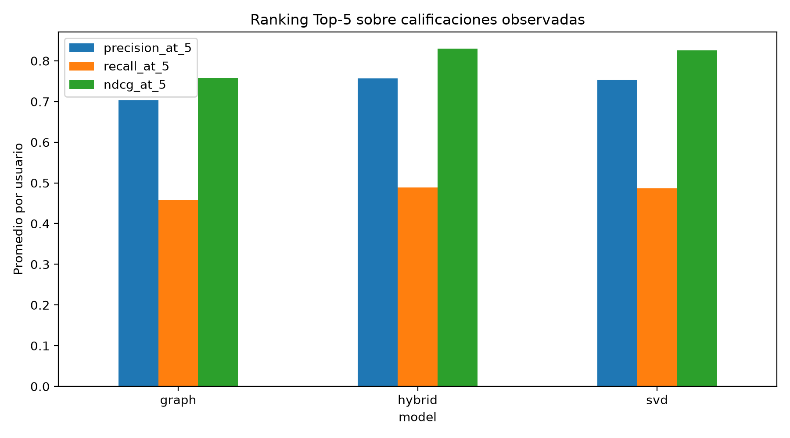

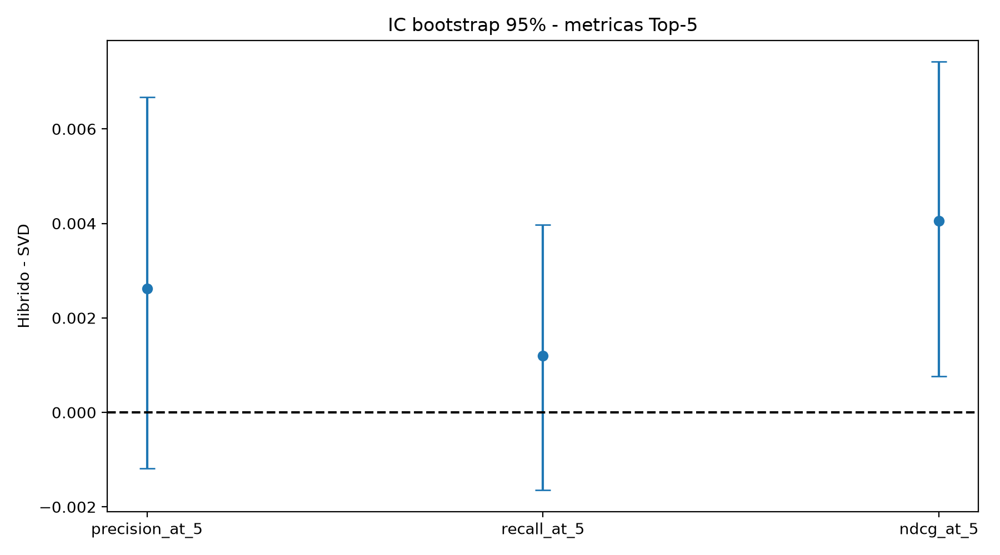

El intervalo bootstrap al 95 % para la mejora de NDCG@5 fue:

$$
[0.000760,\ 0.007422].
$$

Los intervalos para precisión y exhaustividad incluyeron cero.

**Limitación:** esta evaluación se realizó sobre películas calificadas y observadas en prueba, no sobre todo el catálogo de películas candidatas.

## 9. Validación temporal

Se estudiaron tres protocolos:

1. División aleatoria de calificaciones.
2. Separación cronológica dentro del historial de cada usuario.
3. Separación cronológica global.

### Evaluación cronológica global

| Modelo | RMSE | MAE |
|---|---:|---:|
| SVD | 1.009797 | 0.812433 |
| Grafo | 1.118474 | 0.938317 |
| Híbrido | 1.009797 | 0.812433 |

En validación se seleccionó $\alpha=0$, por lo que el híbrido coincidió con SVD.

### Problema de usuarios nuevos

De las 15 000 calificaciones de prueba, 12 568 corresponden a observaciones con usuario o película no vistos en los datos de desarrollo.

Esto muestra que la evaluación cronológica presenta un escenario de generalización diferente al de las particiones aleatorias.

### Modelos adicionales

Se analizaron también:

- Suavizado bayesiano de medias por película.
- Regresión Ridge basada en géneros cinematográficos.
- Modelo BaselineOnly.
- SVD con ajuste específico en validación cronológica.

Estos experimentos no demostraron una mejora consistente frente a SVD.

## 10. Controlabilidad de redes

Como extensión matemática independiente, se construyó una red de 30 películas basada en co-calificaciones.

Se estudió el sistema lineal discreto:

$$
x_{t+1}=Ax_t+Bu_t,
$$

donde $A$ representa un operador de propagación y $B$ identifica nodos de intervención.

### Estabilidad

El operador fue normalizado para tener radio espectral:

$$
\rho(A)=0.8<1.
$$

Por tanto, el sistema discreto es asintóticamente estable.

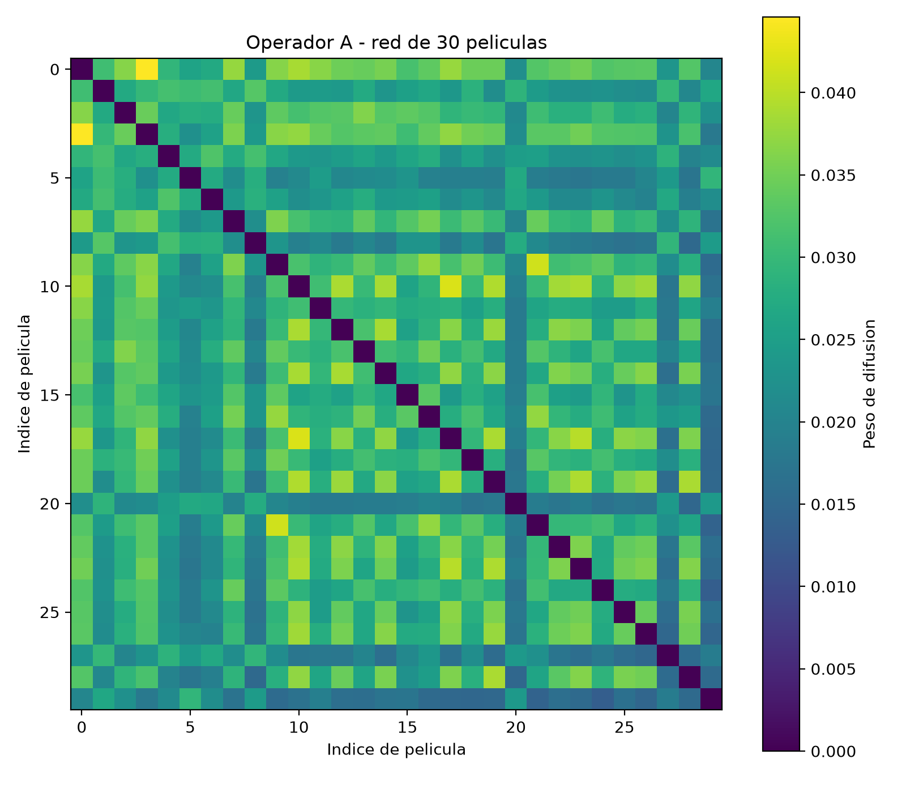

### Gramiano de controlabilidad

Para un sistema estable:

$$
W=\sum_{k=0}^{\infty}A^kBB^\top(A^\top)^k.
$$

Equivalentemente:

$$
W=AWA^\top+BB^\top.
$$

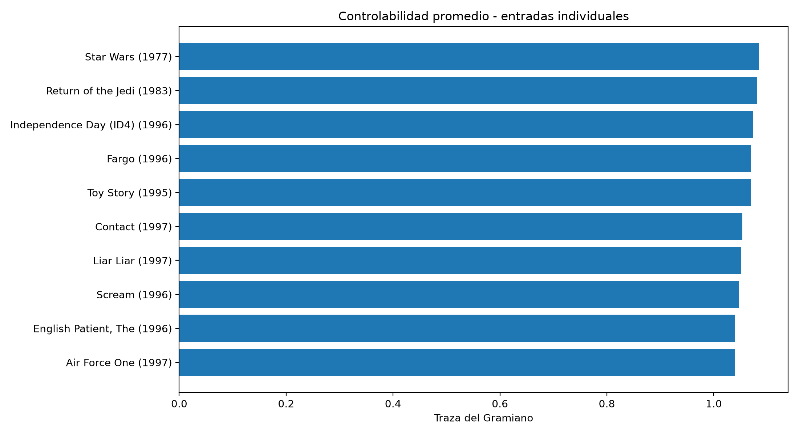

### Selección de nodos

Se compararon estrategias basadas en popularidad, traza individual y selección voraz.

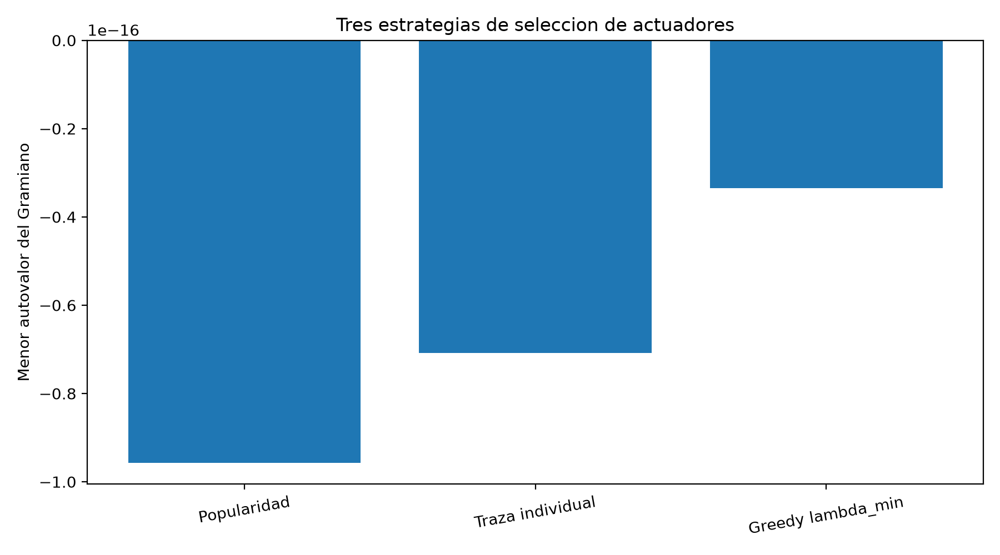

También se evaluaron 100 selecciones aleatorias mediante Monte Carlo.

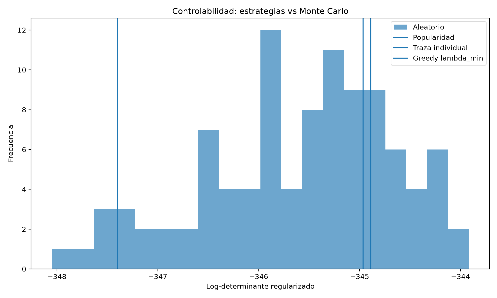

Se utilizó el criterio:

$$
J_\varepsilon(B)=\log\det(W_B+\varepsilon I).
$$

Los resultados dependen del parámetro de regularización y del criterio de selección.

### Advertencia matemática

Aunque las comprobaciones PBH numéricas reportaron rango completo, los valores singulares extremadamente pequeños revelaron un condicionamiento numérico desfavorable.

Por tanto, no se establece una conclusión de controlabilidad práctica robusta.

**Este laboratorio es exploratorio. No demuestra control sobre preferencias humanas ni que el Gramiano mejore la precisión del recomendador.**

## 11. Discusión científica

Los resultados permiten distinguir tres cuestiones:

**Capacidad predictiva:** SVD supera a KNN en el protocolo original.

**Complementariedad estructural:** incorporar una contribución pequeña de similitud entre películas mejora ligeramente a SVD en particiones aleatorias.

**Generalización temporal:** la ventaja desaparece en la separación cronológica global, donde predominan las observaciones de usuarios no vistos.

La contribución estructural no garantiza mejor rendimiento en cualquier escenario. Su utilidad depende del conjunto de entrenamiento y del protocolo de evaluación.

## 12. Conclusiones

1. La representación bipartita permite estudiar actividad, popularidad y comunidades de la red.
2. SVD proporciona mejores predicciones que KNN en el experimento principal.
3. El híbrido SVD-grafo presenta mejoras pequeñas bajo divisiones aleatorias.
4. La ventaja del híbrido no se conserva en la evaluación cronológica global.
5. La incertidumbre estadística y el análisis temporal son necesarios para interpretar correctamente las mejoras.
6. El laboratorio de controlabilidad revela dificultades de condicionamiento numérico y diferencias entre criterios de selección de nodos.

Estos resultados constituyen evidencia experimental exploratoria, no una demostración de superioridad universal ni de originalidad científica publicable.

## 13. Reproducibilidad

### Preparación

En Windows PowerShell:

    python -m venv .venv
    .\.venv\Scripts\python.exe -m pip install -r requirements.txt

Descargar MovieLens 100K desde GroupLens y extraerlo en:

    data/ml-100k/

### Experimentos principales

    .\.venv\Scripts\python.exe src\01_network_analysis.py
    .\.venv\Scripts\python.exe src\02_communities.py
    .\.venv\Scripts\python.exe src\03_recommenders.py
    .\.venv\Scripts\python.exe src\04_optimization.py

### Extensiones

Los experimentos adicionales están organizados en `src/`, desde `06_research_lab.py` hasta `18_temporal_baselines.py`.

El módulo `hybrid_core.py` contiene funciones compartidas del recomendador híbrido.

### Auditorías

    .\.venv\Scripts\python.exe src\05_audit.py
    .\.venv\Scripts\python.exe src\19_research_audit.py

Los archivos CSV se encuentran en `outputs/` y las figuras en `figures/`.

Las auditorías verifican coherencia de resultados guardados; no sustituyen una reproducción completa desde cero.

## 14. Referencias

- [GroupLens Research — MovieLens 100K](https://grouplens.org/datasets/movielens/100k/)
- [NetworkX — Documentación](https://networkx.org/documentation/stable/)
- [Surprise — Documentación](https://surpriselib.com/)
- [SciPy — Documentación](https://docs.scipy.org/doc/scipy/)
- [Scikit-learn — Documentación](https://scikit-learn.org/stable/)
